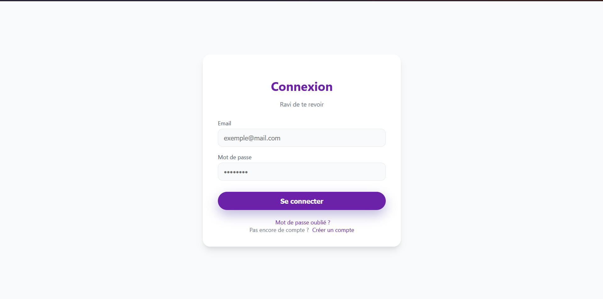
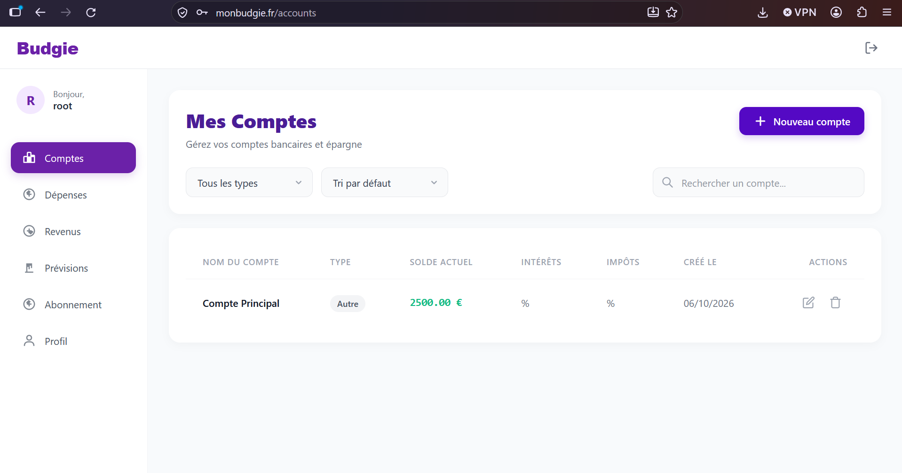
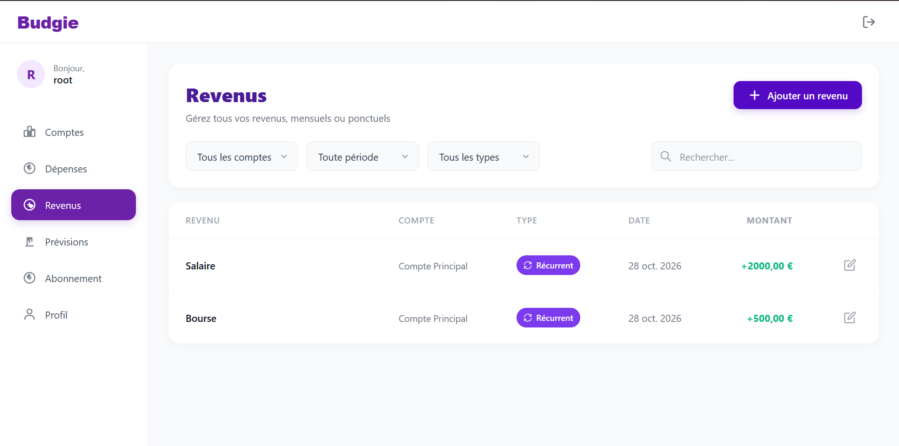
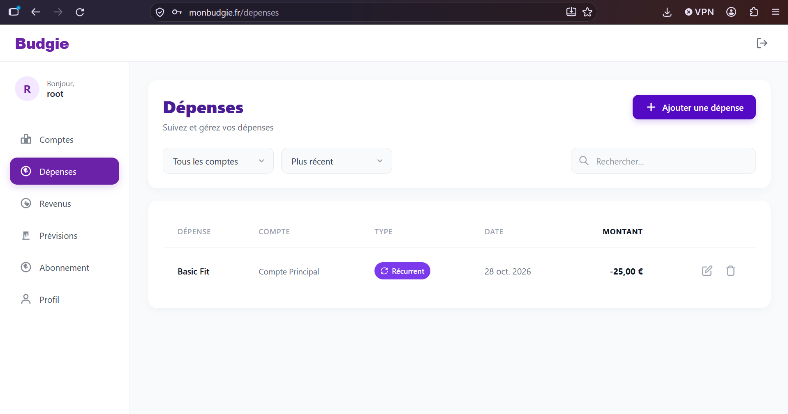
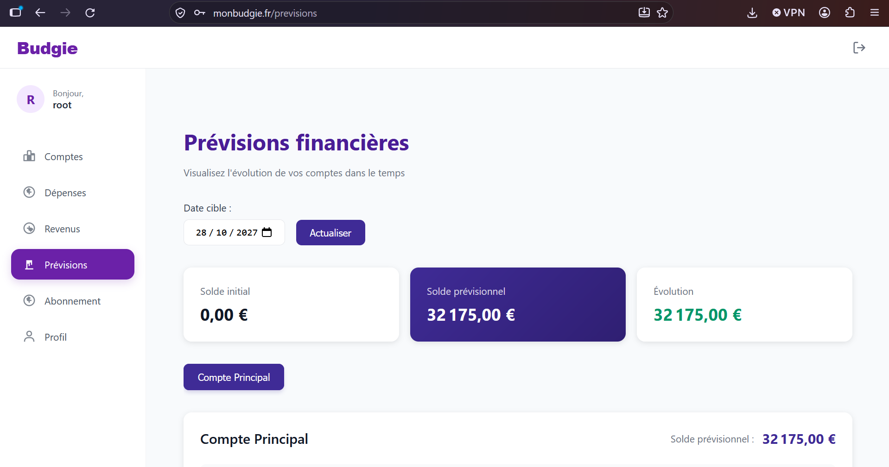

<div align="center">

# Budgie

### Gérez votre budget. Anticipez vos dépenses. Gardez le contrôle de vos finances.

**Application web de gestion financière personnelle et de prévisions budgétaires.**

[](https://vuejs.org/)
[](https://expressjs.com/)
[](https://www.postgresql.org/)
[](https://www.docker.com/)
[](https://github.com/features/actions)

**[Découvrir l'application](https://monbudgie.fr)** · **[Code source](https://github.com/Maissane-abd/Budgie-typeScript)**


</div>

---

## Sommaire

- [Présentation](#-présentation)
- [Fonctionnalités de la V1](#-fonctionnalités-de-la-v1)
- [Aperçu de l'application](#-aperçu-de-lapplication)
- [Stack technique](#-stack-technique)
- [Architecture](#-architecture)
- [Installation locale](#-installation-locale)
- [Commandes utiles](#-commandes-utiles)
- [Vérifications locales](#vérifications-locales)
- [CI/CD et déploiement](#-cicd-et-déploiement)
- [Sécurité](#-sécurité)
- [Roadmap](#-roadmap)
- [Documentation et ressources](#-documentation-et-ressources)
- [Auteur](#-auteur)

## Présentation

**Budgie** est une application web destinée aux particuliers qui souhaitent centraliser leurs comptes financiers, suivre leurs revenus et leurs dépenses, et anticiper l'évolution de leur budget.

Le projet part d'un constat simple : il n'est pas toujours facile de savoir combien d'argent il restera à la fin du mois, en particulier lorsqu'il faut tenir compte de revenus variables, de charges récurrentes et de dépenses exceptionnelles.

Budgie permet de **visualiser une situation financière prévisionnelle**, à partir des opérations renseignées, afin de repérer les périodes où le solde risque de devenir insuffisant et de prendre des décisions plus éclairées.

### Pourquoi ce projet ?

Budgie répond à deux objectifs complémentaires :

- **Un besoin utilisateur :** disposer d'un outil accessible de suivi et d'anticipation budgétaires, encourageant une gestion financière responsable.
- **Un objectif de développement :** concevoir, déployer et maintenir de bout en bout une application full-stack, en pratiquant l'architecture logicielle, l'API REST, la gestion de données, Docker, la CI/CD et l'administration serveur.

La **V1** est un _MVP_ (_Minimum Viable Product_) : elle se concentre volontairement sur les fonctionnalités essentielles, avec une feuille de route d'amélioration progressive.

## Fonctionnalités de la V1

| Domaine                | Fonctionnalités                                                                        |
| ---------------------- | -------------------------------------------------------------------------------------- |
| **Authentification**   | Inscription, connexion, déconnexion et accès aux ressources protégées par JWT.         |
| **Comptes financiers** | Création et gestion de comptes courants, d'épargne, d'investissement ou personnalisés. |
| **Revenus**            | Enregistrement de revenus ponctuels ou récurrents, associés à un compte.               |
| **Dépenses**           | Enregistrement de dépenses ponctuelles ou récurrentes, associées à un compte.          |
| **Prévisions**         | Estimation de l'évolution des soldes selon les revenus et les charges enregistrés.     |
| **Visualisation**      | Consultation des prévisions sous forme graphique et chiffrée.                          |

**Limite de la V1 :** le plan gratuit prévoit actuellement un maximum de **deux comptes financiers** (pour la V2 on enlèvera cette limite).

> [!NOTE]
> Les prévisions sont des estimations calculées à partir des informations fournies par l'utilisateur. Elles ne constituent ni une garantie de solde futur ni un conseil financier personnalisé.

## Aperçu de l'application

Les captures d'écran seront intégrées ici à partir de l'application réelle, idéalement avec des données de démonstration.

| Écran                  | Fonction                                    |
| ---------------------- | ------------------------------------------- |
| **Connexion**          | Accéder à Budgie et à son espace personnel. |
| **Comptes**            | Gérer les différents comptes financiers.    |
| **Revenus / dépenses** | Ajouter et organiser les opérations.        |
| **Prévisions**         | Visualiser l'évolution estimée des soldes.  |







## Stack technique

| Couche               | Technologies                                | Rôle                                                              |
| -------------------- | ------------------------------------------- | ----------------------------------------------------------------- |
| **Frontend**         | Vue.js 3, Vite, Pinia, Vue Router, HTML/CSS | Interface utilisateur, navigation et gestion d'état.              |
| **Backend**          | Node.js, Express.js, TypeScript             | API REST, règles métier et calculs de prévision.                  |
| **Authentification** | JWT, bcrypt                                 | Contrôle des accès et hachage des mots de passe.                  |
| **Base de données**  | PostgreSQL 15                               | Stockage relationnel et persistance des données.                  |
| **Conteneurisation** | Docker, Docker Compose                      | Exécution et orchestration des services.                          |
| **Infrastructure**   | VPS OVHcloud, Debian 12, Nginx              | Hébergement et routage des requêtes.                              |
| **HTTPS**            | Certbot, TLS                                | Chiffrement des communications web.                               |
| **Automatisation**   | GitHub Actions                              | Vérifications automatisées du code et préparation des livraisons. |

## Architecture

Budgie est organisé autour de trois services Docker :

```text
                Utilisateur / navigateur
                          │
                          ▼
                     Frontend Vue 3
                          │
                     Requêtes API
                          ▼
                 Backend Node / Express
                          │
                    Requêtes SQL
                          ▼
                      PostgreSQL
```

En production, l'application est hébergée sur un **VPS OVHcloud sous Debian 12**. Nginx intervient dans le routage des requêtes, tandis que HTTPS protège les échanges avec le navigateur.

La configuration locale est définie dans [`compose.yml`](compose.yml) ; une configuration de production distincte est disponible dans [`compose.production.yml`](compose.production.yml).

### Organisation du dépôt

```text
Budgie-typeScript/
├── .github/workflows/        # Automatisation GitHub Actions
├── backend/                  # API et logique métier
├── db/                       # Initialisation de PostgreSQL
├── docs/                     # Documentation complémentaire
├── frontend/                 # Application Vue.js
├── nginx/                    # Configuration du serveur web
├── .env.example              # Modèle de variables d'environnement
├── compose.yml               # Environnement Docker local
├── compose.production.yml    # Configuration Docker de production
└── README.md
```

## Installation locale

### 1. Prérequis

Installer :

- [Git](https://git-scm.com/)
- [Docker](https://docs.docker.com/get-docker/) avec [Docker Compose](https://docs.docker.com/compose/)

Node.js et npm sont utiles pour travailler sur les services séparément, mais ne sont pas nécessaires pour une exécution entièrement conteneurisée.

Vérifier les outils :

```bash
git --version
docker --version
docker compose version
```

### 2. Cloner le projet

```bash
git clone https://github.com/Maissane-abd/Budgie-typeScript.git
cd Budgie-typeScript
```

### 3. Configurer l'environnement

Créer les fichiers de configuration à partir des modèles fournis :

```bash
cp .env.example .env
cp backend/.env.example backend/.env
```

Dans le fichier **`.env`** à la racine, renseigner notamment :

```dotenv
PGHOST=
PGPORT=
PGUSER=
PGPASSWORD=
PGDATABASE=
NODE_ENV=development
JWT_SECRET=remplacer_par_une_valeur_aleatoire_longue
JWT_EXPIRES_IN=1d
```

Dans **`backend/.env`**, renseigner au minimum les paramètres nécessaires à l'API :

```dotenv
PORT=
JWT_SECRET=utiliser_le_meme_secret_que_dans_le_fichier_racine
JWT_EXPIRES_IN=1d
```

Utiliser un secret JWT fort et non publié. Ne jamais committer de fichier `.env` contenant de vrais secrets.

### 4. Construire et démarrer les services

Depuis la racine du dépôt :

```bash
docker compose up -d --build
```

Vérifier que les conteneurs ont démarré :

```bash
docker compose ps
```

Consulter leurs journaux en cas de problème :

```bash
docker compose logs -f
```

Le fichier Compose local prévoit trois services : **`frontend`**, **`backend`** et **`db`**. La base PostgreSQL est initialisée via le script [`db/init.sql`](db/init.sql) lorsque son volume de données est créé pour la première fois.

### 5. Ouvrir Budgie

Une fois les services opérationnels, ouvrir :

**➡️ [http://localhost](http://localhost)**

### 6. Vérifier l'installation

Créer un utilisateur de test, se connecter, ajouter un compte, enregistrer un revenu et une dépense, puis consulter les prévisions. Vérifier également que les données persistent après le redémarrage des services.

## Commandes utiles

```bash
# Démarrer les services existants
docker compose up -d

# Reconstruire et démarrer après des modifications
docker compose up -d --build

# État des conteneurs
docker compose ps

# Journaux de tous les services
docker compose logs -f

# Journaux du backend
docker compose logs -f backend

# Arrêter et supprimer les conteneurs
docker compose down
```

La commande `docker compose down` **ne supprime pas les volumes nommés** par défaut. Attention : `docker compose down -v` supprime également les volumes gérés par Compose, ce qui peut entraîner la perte des données locales PostgreSQL.

## Vérifications locales

Avant d’ouvrir une Pull Request, exécuter les vérifications suivantes
depuis la racine du dépôt, après installation des dépendances.

### Backend

```bash
npm --prefix backend run lint
npm --prefix backend run typecheck
npm --prefix backend test
npm --prefix backend run build
```

### Frontend

```bash
npm --prefix frontend/app run lint
npm --prefix frontend/app test
npm --prefix frontend/app run build
```

Le frontend ne dispose pas encore de script `typecheck`. Ajouter cette vérification
lorsque le contrôle des types sera configuré.

## 🔄 CI/CD et déploiement

Budgie utilise **GitHub Actions** pour automatiser certaines vérifications du projet, notamment :

1. Récupérer le code source.
2. Installer les dépendances nécessaires.
3. Vérifier le typage du backend TypeScript.
4. Contrôler la compilation du frontend et du backend.
5. Signaler les erreurs détectées pendant ces étapes.

Les workflows sont consultables dans [`.github/workflows/`](.github/workflows/).

Le déploiement de production s'appuie sur un VPS OVHcloud, Docker et Nginx. Une configuration spécifique est conservée dans `compose.production.yml`.

**Intégration continue et déploiement sont deux étapes distinctes :** une compilation réussie ne garantit pas à elle seule le bon fonctionnement de la version déployée.

## Sécurité

Plusieurs mesures contribuent à la sécurisation de Budgie :

- **HTTPS/TLS :** chiffrement des communications navigateur–serveur, avec des certificats gérés par Certbot.
- **JWT :** authentification et protection des routes nécessitant un utilisateur connecté.
- **bcrypt :** hachage des mots de passe avant leur stockage.
- **SSH :** administration distante du VPS avec authentification par clé publique.
- **UFW :** filtrage des accès réseau ; les ports administrés sur le serveur sont notamment `22`, `80` et `443`.
- **Variables d'environnement :** séparation des paramètres sensibles et du code source.

Ces mécanismes constituent une base de protection et ne remplacent ni les tests de sécurité ni la maintenance régulière du serveur et des dépendances.

## 🗺 Roadmap

Fonctionnalités **envisagées**, non disponibles par défaut dans la V1 :

- [ ] **Prévisions avancées :** intégration des intérêts et distinction des taux annuels/mensuels.
- [ ] **Épargne automatisée :** règles affectant un pourcentage d'un revenu à un compte d'épargne, sans double comptabilisation des transferts internes.
- [ ] **Blog pédagogique :** articles sur les budgets, l'épargne, l'investissement et les lectures financières, avec une stratégie SEO.
- [ ] **Tableau de bord d'administration :** statistiques d'utilisation et indicateurs de fonctionnement, dans le respect de la vie privée.
- [ ] **Qualité et maintenance :** tests automatisés plus complets, validation renforcée, protection des branches, performances et accessibilité.

Cette roadmap est indicative et pourra évoluer selon les besoins et les priorités du projet.

## 📚 Documentation et ressources

**Frontend :** [Vue.js](https://vuejs.org/guide/introduction.html) · [Vite](https://vite.dev/guide/) · [Pinia](https://pinia.vuejs.org/) · [Vue Router](https://router.vuejs.org/)

**Backend :** [Node.js](https://nodejs.org/en/learn) · [Express](https://expressjs.com/) · [TypeScript](https://www.typescriptlang.org/docs/) · [PostgreSQL](https://www.postgresql.org/docs/)

**Infrastructure :** [Docker](https://docs.docker.com/) · [Docker Compose](https://docs.docker.com/compose/) · [GitHub Actions](https://docs.github.com/en/actions) · [Nginx](https://nginx.org/en/docs/) · [Debian](https://www.debian.org/doc/) · [Certbot](https://certbot.eff.org/)

## 👨‍💻 Auteur

**Maïssane Abdallah** — Développement full-stack, infrastructure et déploiement.

- [GitHub : Maissane-abd](https://github.com/Maissane-abd)
- [Application : monbudgie.fr](https://monbudgie.fr)

---

<div align="center">

**Budgie — Mieux comprendre ses finances pour mieux anticiper l'avenir.**

</div>
