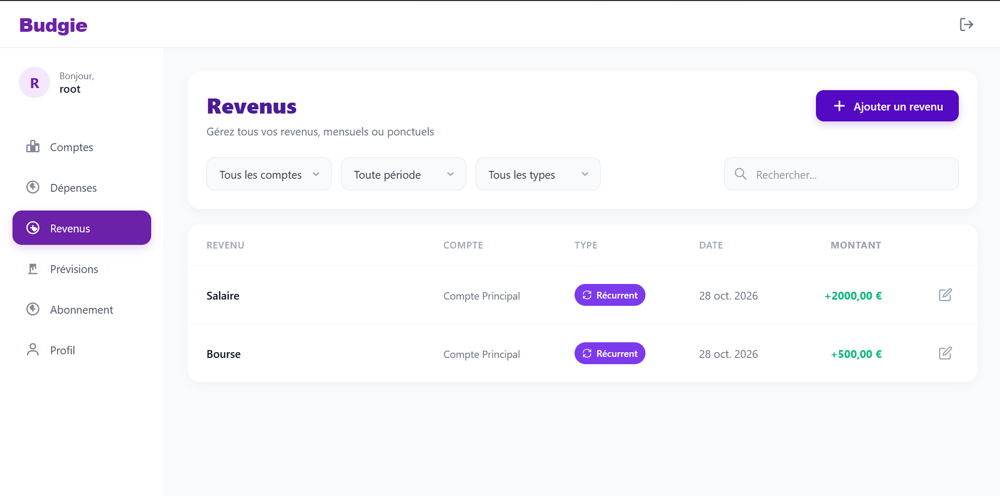
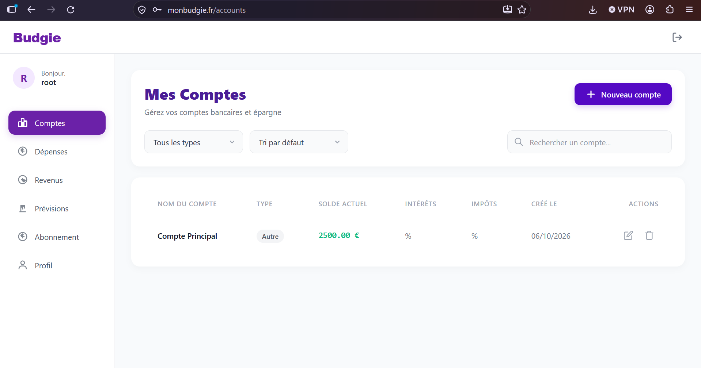
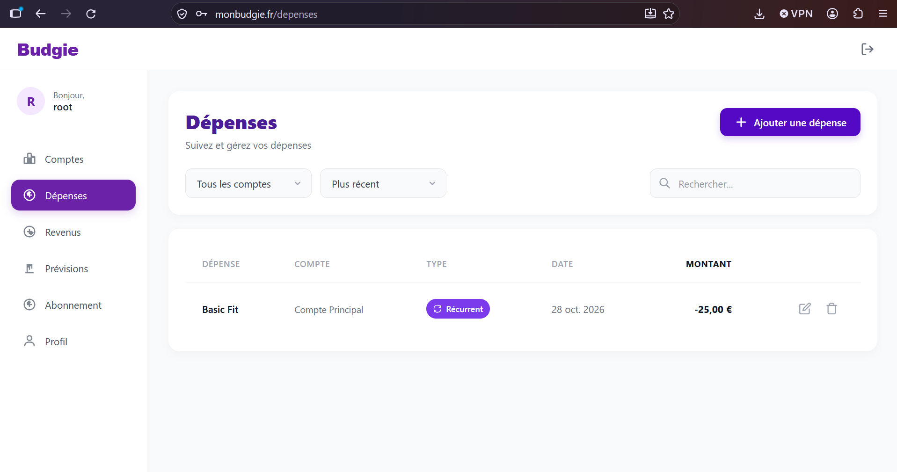
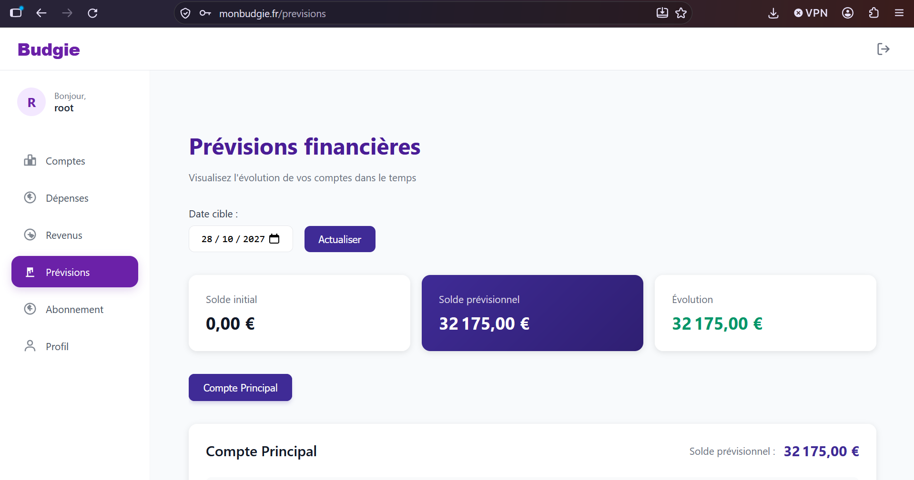
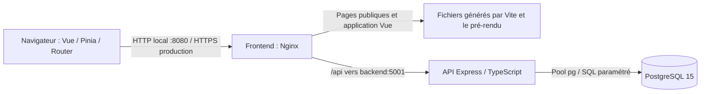

<div align="center">

# Budgie — v2

### Gérez votre budget. Anticipez vos dépenses.

Application web de gestion financière personnelle et de prévisions budgétaires.

[](https://vuejs.org/)
[](https://www.typescriptlang.org/)
[](https://expressjs.com/)
[](https://www.postgresql.org/)

**[Application](https://monbudgie.fr)** · **[Changelog v2](CHANGELOG.md)** · **[Roadmap v2.1](docs/roadmap-v2.1.md)**



</div>

La v2 désigne ici l'état fonctionnel du dépôt documenté le **26 novembre 2026**.
Les versions npm restent `1.0.0` à la racine et dans le backend, et `0.0.0` dans le
frontend ; aucun tag Git v2 n'est présent dans le dépôt examiné. Ce document ne
certifie pas la version actuellement déployée sur le site.

## Sommaire

- [Fonctionnalités](#fonctionnalités)
- [Stack technique](#stack-technique)
- [Architecture](#architecture)
- [Installation](#installation)
- [Commandes et vérifications](#commandes-et-vérifications)
- [Sécurité](#sécurité)
- [CI/CD](#cicd)
- [Limites connues](#limites-connues)
- [Roadmap v2.1](#roadmap-v21)
- [Documentation](#documentation)

## Fonctionnalités

Budgie centralise les comptes, revenus et dépenses saisis par l'utilisateur pour
estimer l'évolution de ses soldes. Les opérations sont renseignées manuellement.

| Domaine             | Disponible dans le code v2                                                                                                                                                                           |
| ------------------- | ---------------------------------------------------------------------------------------------------------------------------------------------------------------------------------------------------- |
| Authentification    | Inscription, connexion par JWT, déconnexion côté navigateur et garde de navigation. Un compte principal est créé à l'inscription.                                                                    |
| Profil              | Consultation, modification du nom et de l'adresse e-mail, suppression du compte utilisateur.                                                                                                         |
| Comptes             | Création, modification et suppression ; solde initial, date d'ouverture, devise, taux d'intérêt annuel et taux d'imposition. Plafond API de **10 comptes par utilisateur**, compte principal inclus. |
| Revenus et dépenses | Création, consultation, modification et suppression ; association à un compte, filtres dans l'interface, opérations ponctuelles ou récurrentes.                                                      |
| Récurrences         | Intervalles en jours, mois ou années, avec date de fin facultative.                                                                                                                                  |
| Soldes              | Solde courant recalculé à partir du solde initial et des opérations ; projection à douze mois sur la liste des comptes.                                                                              |
| Prévisions          | Date cible personnalisable jusqu'à **100 ans** à partir d'aujourd'hui, détail mensuel par compte, revenus, dépenses, intérêts et soldes. Graphique des douze premiers mois.                          |
| Intérêts            | Capitalisation annuelle à l'anniversaire du compte, après application du taux d'imposition paramétré. Les taux sont saisis en pourcentage : `2.5` pour 2,5 %.                                        |
| Pages publiques     | Accueil, mentions légales, politique de confidentialité et conditions d'utilisation pré-rendus à la compilation ; métadonnées, URL canoniques, `robots.txt` et sitemap.                              |

**Point bloquant sur une base neuve :** le schéma `db/init.sql` ne crée plus les
tables `plans` et `subscriptions`, encore interrogées à la connexion et par
`/api/auth/me`. Ces parcours peuvent donc renvoyer une erreur serveur après une
inscription réussie. Voir les [limites connues](docs/known-limitations.md) avant
d'utiliser une nouvelle installation.

Les prévisions dépendent des données saisies et du modèle de calcul décrit dans
l'[architecture](docs/architecture.md). Elles restent des estimations.

<details>
<summary>Captures de l'interface</summary>






Les captures présentes dans le dépôt sont illustratives et peuvent précéder les
dernières évolutions de l'interface.

</details>

## Stack technique

Les versions ci-dessous correspondent aux manifestes et configurations du dépôt.

| Couche                       | Technologies                                                      | Rôle                                                                              |
| ---------------------------- | ----------------------------------------------------------------- | --------------------------------------------------------------------------------- |
| Frontend                     | Vue 3.5, TypeScript 6, Vite 7                                     | Interface Vue en composants `.vue`, compilation et pré-rendu des pages publiques. |
| Navigation et état           | Vue Router 4, Pinia 3                                             | Routes publiques/privées, profil de l'utilisateur en mémoire.                     |
| Client HTTP et notifications | Axios 1, Vue Toastification 2 RC                                  | Appels JSON à l'API et retours à l'utilisateur.                                   |
| Backend                      | Node.js, Express 5, TypeScript 6, `tsx`                           | API REST et calcul des prévisions.                                                |
| Données                      | PostgreSQL 15, pilote `pg` 8                                      | SQL paramétré, pool de connexions et persistance.                                 |
| Authentification             | `jsonwebtoken` 9, `bcryptjs` 3                                    | JWT signés et hachage des mots de passe.                                          |
| Qualité                      | ESLint 10, Prettier 3, Vitest 5, Vue Test Utils, jsdom, `vue-tsc` | Lint, formatage, tests et vérification des types.                                 |
| Exécution et livraison       | Docker Compose, Nginx, GitHub Actions, SSH                        | Services conteneurisés, reverse proxy et déploiement vers le VPS.                 |

La CI utilise **Node.js 22** ; pour les commandes locales, utiliser **Node.js 22.13+
dans la branche 22** afin de couvrir les exigences des outils installés. Les deux
Dockerfiles utilisent encore `node:20-alpine` : cet écart fait partie de la
[roadmap v2.1](docs/roadmap-v2.1.md). Le paquet Stripe subsiste dans les dépendances
backend, mais aucune route de paiement ou de webhook n'est montée par l'application.

## Architecture



Trois services Compose : `frontend` sert les fichiers statiques et transmet les
requêtes API ; `backend` applique l'authentification, les contrôles d'accès et les
calculs ; `db` conserve les données dans le volume `db_data`.

L'API montée dans [`backend/src/app.ts`](backend/src/app.ts) expose :

| Préfixe           | Responsabilité                                                                |
| ----------------- | ----------------------------------------------------------------------------- |
| `/api/auth`       | Inscription, connexion et profil `/me`.                                       |
| `/api/accounts`   | Gestion des comptes et calcul des soldes.                                     |
| `/api/revenus`    | Revenus et règles de récurrence.                                              |
| `/api/expenses`   | Dépenses et règles de récurrence.                                             |
| `/api/previsions` | Projection de tous les comptes de l'utilisateur.                              |
| `/health`         | Réponse HTTP de disponibilité du processus backend, sans contrôle PostgreSQL. |

Les routes revenus/dépenses délèguent leurs traitements aux contrôleurs. Les routes
authentification, comptes et prévisions contiennent encore directement leur logique.
Le modèle SQL définit cinq tables : `users`, `accounts`, `transactions`,
`recurrence_rules`, `transaction_exceptions`. Cette dernière n'est pas intégrée au
calcul des prévisions ; son routeur n'est pas monté.

```text
.github/workflows/      CI/CD et automatisation documentaire
backend/src/           API : routes, contrôleurs, middlewares, pool SQL, utilitaires
backend/tests/         Tests Vitest du backend
frontend/app/src/      Vues, composants, routes, store Pinia et types TypeScript
frontend/app/scripts/  Pré-rendu et vérification des pages publiques
frontend/app/tests/    Tests Vitest de l'interface
db/                    Schéma initial et ancien jeu de données de démonstration
nginx/                 Configurations locale et production
docs/                  Installation, architecture, limites et roadmap
compose.yml            Trois services et volume PostgreSQL local
compose.production.yml Surcharge de production à combiner avec compose.yml
```

Voir l'[architecture détaillée](docs/architecture.md) pour le cycle des requêtes,
le modèle des prévisions et les différences local/production.

## Installation

Prérequis : Git, Docker avec Compose v2 prenant en charge `!reset`. Node.js et npm
sont nécessaires pour développer ou lancer les vérifications hors conteneurs.

```bash
git clone https://github.com/Maissane-abd/Budgie-typeScript.git
cd Budgie-typeScript
cp -n .env.example .env
cp -n backend/.env.example backend/.env
```

Sous PowerShell, utiliser les commandes `Copy-Item` conditionnelles du
[guide d'installation](docs/installation.md#2-configurer-lenvironnement) pour
préserver d'éventuels fichiers locaux. Remplir les fichiers avec des valeurs
locales, sans réutiliser de secret de production :

| Fichier                          | Variables utilisées                                                                                                                                      |
| -------------------------------- | -------------------------------------------------------------------------------------------------------------------------------------------------------- |
| `.env`                           | `PGUSER`, `PGPASSWORD`, `PGDATABASE`, `JWT_SECRET` ; Compose impose `PGHOST=db` et `PGPORT=5432` au backend.                                             |
| `backend/.env`                   | `PORT=5001` ; `JWT_SECRET` et variables PostgreSQL également nécessaires si l'API est exécutée hors Docker. Le `JWT_SECRET` racine prévaut dans Compose. |
| `frontend/app/.env` (facultatif) | `VITE_API_BASE`, avec `/api` comme valeur par défaut. Valeur incorporée au build et visible du navigateur.                                               |

`JWT_EXPIRES_IN` figure dans les modèles mais n'est pas lu : la durée du JWT est
fixée à un jour dans le code. Le frontend via Nginx fonctionne avec `/api`, sans
configuration supplémentaire.

**Avant de démarrer :** suivre la section [préparation de la construction locale](docs/installation.md#3-préparer-la-construction-locale).
Elle fournit un fichier `compose.local.yml` pour référencer les Dockerfiles en
minuscules et éviter que le montage du backend masque le dossier `dist` de l'image.
Les commandes suivantes supposent ce fichier créé :

```bash
docker compose -f compose.yml -f compose.local.yml config --quiet
docker compose -f compose.yml -f compose.local.yml up -d --build
docker compose -f compose.yml -f compose.local.yml ps
docker compose -f compose.yml -f compose.local.yml logs -f backend
```

| Service local                | Adresse                                                |
| ---------------------------- | ------------------------------------------------------ |
| Application et API via Nginx | `http://localhost:8080` et `http://localhost:8080/api` |
| Backend direct               | `http://localhost:5001`                                |
| PostgreSQL                   | `localhost:5432`                                       |

Le SQL d'initialisation s'exécute à la création d'un volume PostgreSQL vide. Il ne
met pas à jour une base existante. Le fichier de démonstration `db/seed.sql` n'est
pas chargé par défaut.

Pour arrêter les services tout en conservant les données :

```bash
docker compose -f compose.yml -f compose.local.yml down
```

L'option `down -v` supprimerait le volume des données. Les erreurs de schéma sur
`plans`/`subscriptions` nécessitent une correction applicative ou une migration ;
recréer le volume avec le même `init.sql` ne les résout pas.

## Commandes et vérifications

Installer séparément les trois ensembles de dépendances : la racine ne configure
pas de workspaces npm.

```bash
npm ci
npm --prefix backend ci
npm --prefix frontend/app ci

npm run lint
npm run typecheck
npm --prefix frontend/app run typecheck
npm test
npm run build
npm --prefix frontend/app run verify:public
```

Sous PowerShell, utiliser `npm.cmd` si la stratégie d'exécution bloque `npm.ps1`.

| Commande                                      | Portée                                                                      |
| --------------------------------------------- | --------------------------------------------------------------------------- |
| `npm run lint`                                | ESLint backend et frontend, sans avertissement accepté.                     |
| `npm run typecheck`                           | Backend uniquement ; le script frontend ci-dessus complète ce contrôle.     |
| `npm test`                                    | Tests Vitest des deux projets.                                              |
| `npm run build`                               | Compilation backend puis `vue-tsc`, Vite et pré-rendu frontend.             |
| `npm --prefix frontend/app run verify:public` | Contrôle du HTML public généré après le build.                              |
| `npm --prefix backend run dev`                | API en mode surveillance avec `tsx`.                                        |
| `npm --prefix frontend/app run dev`           | Serveur Vite ; les appels API nécessitent une configuration réseau adaptée. |

Vite ne configure pas de proxy API et la liste CORS actuelle n'autorise pas
`http://localhost:5173`. Le démarrage séparé des serveurs requiert donc une
adaptation du proxy ou des origines autorisées, détaillée dans le
[guide d'installation](docs/installation.md). Les tests actuels ne remplacent pas
un essai complet avec une base PostgreSQL neuve.

## Sécurité

Mesures présentes dans les sources :

- JWT signé avec `JWT_SECRET`, obligatoire au démarrage, vérifié par `requireAuth`
  sur les ressources privées ; transmission via `Authorization: Bearer <token>`.
- Hachage des mots de passe avec `bcryptjs`, coût 10. À l'inscription : minimum
  12 caractères, une majuscule, un chiffre ASCII et un symbole ou une ponctuation ;
  maximum 72 octets UTF-8. La validation existe côté client et serveur.
- Requêtes SQL paramétrées et contrôles de propriété des comptes et transactions
  par l'identifiant de l'utilisateur authentifié.
- Fichiers `.env` ignorés par Git ; les valeurs `VITE_*` sont publiques et ne
  doivent contenir aucun secret.
- Configuration Nginx de production avec TLS 1.2/1.3, certificats Let's Encrypt
  montés depuis le serveur et redirections HTTPS/domaine canonique.
- En production, la surcharge Compose retire les ports publics du backend et de
  PostgreSQL ; le déploiement SSH vérifie la clé d'hôte fournie.

Points à renforcer : JWT conservé dans `localStorage`, absence de révocation et
de renouvellement, absence de limitation des tentatives de connexion, validation
métier inégale et configuration CORS à revoir. Le mode `DATABASE_URL` du pool SQL
désactive la vérification du certificat PostgreSQL (`rejectUnauthorized: false`).
Les contrôles `/health` ne prouvent pas le bon fonctionnement de l'authentification
ou de la base.

La [revue des pages juridiques](docs/legal-review.md) signale notamment l'absence
de sauvegarde déclarée et des règles de conservation restant à définir. Les pages
publiées ne constituent pas une validation juridique. Les constats de cette
documentation reposent sur les fichiers du dépôt, sans audit du VPS.

## CI/CD

Le workflow [CI/CD Budgie](.github/workflows/deploy.yml) se déclenche sur les pushs
vers `main`, les pull requests vers `main` ou `dev`, et manuellement.

| Job         | Contrôles exécutés                                                                                      |
| ----------- | ------------------------------------------------------------------------------------------------------- |
| Backend     | Ubuntu 24.04, Node 22, `npm ci`, lint, `typecheck`, build.                                              |
| Frontend    | Ubuntu 24.04, Node 22, `npm ci`, lint, build avec vérification des types et pré-rendu, `verify:public`. |
| Déploiement | Après réussite des deux jobs, uniquement sur `main` hors événement pull request.                        |

**Les tests Vitest ne sont pas exécutés par ce workflow**, même si les scripts
existent. Aucun test d'intégration PostgreSQL ou parcours navigateur complet n'y
est configuré.

Le déploiement utilise les secrets GitHub `VPS_SSH_KEY`, `VPS_KNOWN_HOSTS` et
`VPS_HOST`, puis se connecte en tant que `debian` dans
`/home/debian/Budgie-typeScript`. Il refuse les modifications Git suivies locales,
récupère `main`, avance en fast-forward vers le SHA déclencheur et vérifie ce SHA.
Il valide ensuite Compose, reconstruit les services avec les deux fichiers
`compose.yml` et `compose.production.yml`, attend leur état de santé avec
`up -d --build --wait`, puis contrôle l'accueil HTTPS avec `curl`.

Les certificats, fichiers d'environnement et outils serveur doivent être préparés
sur le VPS. Les écarts des Dockerfiles et des sondes de santé sont suivis dans les
[limites](docs/known-limitations.md). Le workflow ne prévoit pas de migration,
de sauvegarde préalable ni de retour automatique à la version précédente.

Le workflow documentaire [Vegapunk](.github/workflows/vegapunk-docs.md), distinct
de la livraison, prévoit une PR de documentation en brouillon après fusion dans
`dev` d'une PR qui ne touche pas exclusivement la documentation.

## Limites connues

- Installation neuve bloquée sur certains parcours d'authentification par les
  références résiduelles aux tables d'abonnements ; construction Linux et montage
  local du backend à adapter comme indiqué dans le guide.
- Plafond de dix comptes ; anciennes métadonnées de plan encore incohérentes avec
  ce plafond. Aucun paiement actif, synchronisation bancaire, import/export dédié
  ou transfert automatique entre comptes.
- Prévisions avec intérêts annuels simplifiés, sans exceptions de transaction ni
  conversion de devises ; affichage des prévisions en euros. Les récurrences en
  fin de mois et les calculs monétaires en `Number` demandent des améliorations.
- Couverture de tests partielle et tests absents de la CI ; sauvegarde et retour
  arrière automatisés non fournis par le dépôt.

Le document [Limites connues v2](docs/known-limitations.md) détaille les impacts,
les sources et les précautions d'utilisation.

## Roadmap v2.1

La [roadmap détaillée v2.1](docs/roadmap-v2.1.md) propose des priorités et des
critères de validation, sans date de livraison engagée :

- [ ] Rendre l'installation sur base neuve cohérente et supprimer les dépendances
      résiduelles aux abonnements dans l'authentification.
- [ ] Aligner les Dockerfiles, Node.js, le démarrage Compose et les contrôles de santé.
- [ ] Exécuter les tests en CI et ajouter un parcours d'intégration sur PostgreSQL.
- [ ] Renforcer la validation, les contrôles d'accès testés et la gestion des sessions.
- [ ] Fiabiliser les récurrences calendaires, les montants et le comportement des devises.
- [ ] Mettre en place sauvegarde/restauration, migrations et procédure de retour arrière.
- [ ] Améliorer l'accessibilité et la cohérence des écrans et de la documentation.

## Documentation

| Document                                           | Contenu                                                                  |
| -------------------------------------------------- | ------------------------------------------------------------------------ |
| [CHANGELOG.md](CHANGELOG.md)                       | Évolutions v2 et statut de version.                                      |
| [Installation](docs/installation.md)               | Configuration locale, surcharge Compose, développement et dépannage.     |
| [Architecture](docs/architecture.md)               | Flux, modules, données, authentification et calcul des prévisions v2.    |
| [Diagramme Mermaid](docs/mermaid_diagram.md)       | Services Compose, routage Nginx, persistance et ports locaux/production. |
| [Limites connues](docs/known-limitations.md)       | Comportements incomplets, écarts et impacts.                             |
| [Roadmap v2.1](docs/roadmap-v2.1.md)               | Travaux proposés et critères d'acceptation.                              |
| [Revue des pages juridiques](docs/legal-review.md) | Informations déclarées et points ouverts de la revue.                    |

Les anciennes documentations [API](docs/api.md) et [base de données](docs/database.md)
restent à actualiser et décrivent encore les abonnements retirés. Pour la v2, se reporter au présent README,
à l'architecture et aux sources ; leur remise à niveau est prévue dans la roadmap.

Développement : **Maïssane Abdallah** · [GitHub](https://github.com/Maissane-abd)
· [Budgie](https://monbudgie.fr).
