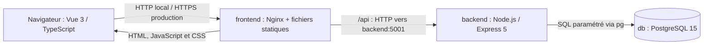

# Architecture logicielle — Budgie V2

Cette description suit les fichiers versionnés au 26 novembre 2026. Elle décrit
les composants existants et les écarts du dépôt, sans certifier l’état du VPS.
Les procédures figurent dans le [guide d’installation](installation.md).

## Vue d’ensemble

Budgie comprend trois services Docker Compose : `frontend`, `backend` et `db`.
Le navigateur exécute Vue ; Nginx, dans le service `frontend`, sert les fichiers
statiques et transmet les requêtes `/api` au backend. Seule l’API accède à PostgreSQL.

La production est prévue sur un VPS avec certificats Let's Encrypt montés dans
Nginx. Aucun serveur de rendu Vue à la demande, worker ou service de paiement
n’est démarré par les fichiers Compose.

## Frontend

L’application se trouve dans [`frontend/app/`](../frontend/app/). Vite construit
les ressources ; `vue-tsc` contrôle les composants TypeScript avant le build.

| Module                             | Responsabilité                                                             |
| ---------------------------------- | -------------------------------------------------------------------------- |
| `src/main.ts`, `App.vue`           | Initialisation de Vue, Pinia, du routeur et des notifications.             |
| `src/views/`                       | Pages comptes, revenus, dépenses, prévisions, profil et authentification.  |
| `src/components/`                  | Formulaires, filtres, tableaux, graphiques et éléments de mise en page.    |
| `src/stores/userStore.ts`          | État utilisateur en mémoire, informations de profil et déconnexion locale. |
| `src/router/`                      | Routes publiques/privées, garde de session et métadonnées de page.         |
| `src/config/api.ts`                | Base des appels Axios : `VITE_API_BASE`, avec `/api` par défaut.           |
| `src/services/accounts.service.ts` | Appels de gestion des comptes ; d’autres vues appellent directement Axios. |
| `src/content/legal.ts`             | Textes et statut de revue des trois pages légales.                         |

Les pages privées sont `/accounts`, `/revenus`, `/depenses`, `/previsions` et
`/profile`. `/login` et `/register` sont réservées aux visiteurs non connectés.
La vue de réinitialisation existe mais sa route est commentée.

### Pages publiques pré-rendues

Après `vue-tsc` et `vite build`, `scripts/prerender-home.mjs` utilise
`src/entry-prerender.ts` et les routes publiques pour produire du HTML à la
construction, sans session ni appel API :

- `dist/index.html` pour l’accueil `/` ;
- un `index.html` dans chacun des répertoires `mentions-legales/`,
  `politique-de-confidentialite/` et `conditions-utilisation/` ;
- `dist/app.html`, coque Vue distincte pour l’authentification et l’espace privé.

Nginx sert explicitement les quatre pages publiques et utilise `app.html` comme
repli pour les autres routes. Le routeur prend ensuite la main dans le navigateur.
Les métadonnées comprennent titre, description, URL canonique et Open Graph.
L’accueil est indexable ; les pages légales en cours de revue, l’authentification
et l’espace privé portent `noindex`. Le sitemap ne liste que l’accueil.
`scripts/check-public-page.mjs` vérifie le HTML généré.

## Backend et routes actives

[`backend/src/app.ts`](../backend/src/app.ts) initialise Express, CORS et le
traitement JSON, puis monte les routeurs ci-dessous. Le serveur écoute sur
`PORT`, ou `5001` par défaut. Le code est compilé en JavaScript dans `backend/dist/`.

| Préfixe monté     | Opérations                                                                     |
| ----------------- | ------------------------------------------------------------------------------ |
| `/api/auth`       | `POST /register`, `POST /login`, puis `GET`, `PUT`, `DELETE /me` authentifiés. |
| `/api/accounts`   | Liste, création, modification et suppression des comptes de l’utilisateur.     |
| `/api/revenus`    | CRUD des revenus, avec règles de récurrence.                                   |
| `/api/expenses`   | CRUD des dépenses, avec règles de récurrence.                                  |
| `/api/previsions` | `GET /` avec `target_date` facultatif pour les projections.                    |
| `/health`         | Réponse `200 OK` du processus Express ; aucun contrôle SQL.                    |

Les routes comptes, prévisions et authentification contiennent directement leur
logique. Revenus et dépenses délèguent à `src/controllers/`.
`src/middlewares/index.ts` centralise CORS, JSON et `requireAuth` ;
`src/models/db.ts` fournit un pool `pg` partagé, avec dix connexions au maximum.
Il n’existe pas de couche de services métier ni d’ORM dans ce parcours.

Les fichiers de routes utilisateurs et exceptions ne sont pas montés dans
`app.ts`. Aucun endpoint de paiement ou webhook Stripe n’y est enregistré.

## Données et persistance

[`db/init.sql`](../db/init.sql) crée l’extension `uuid-ossp` et cinq tables :

| Table                    | Données et relations                                                     |
| ------------------------ | ------------------------------------------------------------------------ |
| `users`                  | Identité, e-mail unique et empreinte du mot de passe.                    |
| `accounts`               | Propriétaire, date d’ouverture, devise, solde initial et taux.           |
| `transactions`           | Revenus/dépenses rattachés à un compte, montant et date de début.        |
| `recurrence_rules`       | Intervalle en jours, mois ou années et date de fin facultative.          |
| `transaction_exceptions` | Exceptions prévues par le schéma, sans intégration dans le calcul actif. |

Les clés étrangères utilisent la suppression en cascade : supprimer un utilisateur
supprime ses comptes, opérations, règles et exceptions. Les montants sont stockés
en `NUMERIC`. Les calculs applicatifs les convertissent ensuite en `Number` JavaScript.

Le schéma et l’authentification présentent un écart : `queryUser`, utilisé à la
connexion et pour le profil, joint `plans` et `subscriptions`, absentes d’`init.sql`.
Une base neuve ne permet donc pas de valider tout le parcours de session actuel.
Le script d’initialisation s’applique uniquement à un volume PostgreSQL vide ;
aucun système de migration n’est fourni. Voir les [limites connues](known-limitations.md).

## Authentification et autorisation

À l’inscription, l’API valide la politique de mot de passe, le hache avec `bcryptjs`
(coût 10), crée l’utilisateur et un compte principal, puis émet un JWT. La politique
exige douze caractères, une majuscule, un chiffre et un caractère spécial, avec un
maximum de 72 octets UTF-8. La connexion compare l’empreinte avant d’émettre un jeton.

Le JWT contient l’identifiant utilisateur et son e-mail. `JWT_SECRET` est obligatoire
au démarrage ; sa durée de validité est fixée à `1d` dans le code. Le frontend conserve
le jeton sous `budgie_token` dans `localStorage` et l’envoie dans
`Authorization: Bearer <token>`. Le store Pinia conserve le profil en mémoire.
La garde du routeur recharge ce profil via `/api/auth/me` lorsque nécessaire.

`requireAuth` vérifie le jeton ; les requêtes des routes financières actives limitent
l’accès aux ressources de l’utilisateur authentifié. La déconnexion efface le jeton
du navigateur ; aucun mécanisme serveur de révocation ou de renouvellement n’est fourni.

## Moteur de soldes et de prévision

[`calculateAccountForecast`](../backend/src/routes/previsions.ts) est utilisé par
la route de prévision et par la présentation des comptes. Il part du solde initial,
génère les occurrences ponctuelles et récurrentes et applique les événements dans
l’ordre chronologique, sans enregistrer les soldes calculés en base.

- `initial_balance` correspond au champ `accounts.balance` enregistré.
- `current_balance` et le `balance` retourné par la route comptes incluent les
  opérations échues jusqu’au jour courant et les intérêts déjà dus.
- `forecast_12m` projette le compte à un an ; `/api/previsions` retourne une
  projection à la date demandée, des détails mensuels et des totaux pour les comptes.

Le taux annuel et le taux de taxation sont exprimés en pourcentage (`2.5` pour
`2,5 %`). À chaque anniversaire de l’ouverture, le calcul ajoute
`solde × taux annuel / 100 × (1 − taxation / 100)`, arrondi à deux décimales.
Les opérations du même jour précèdent ce calcul. L’anniversaire du 29 février est
ramené au 28 février les années non bissextiles.

L’horizon est limité à cent ans à partir d’aujourd’hui. Les exceptions de transaction,
les transferts internes et la conversion de devises ne sont pas intégrés au moteur.
Les détails sur les dates passées et les fins de mois figurent dans les
[limites connues](known-limitations.md).

## Exécution locale et production

| Configuration                            | Réseau, volumes et disponibilité                                                                                                                                                                                                                      |
| ---------------------------------------- | ----------------------------------------------------------------------------------------------------------------------------------------------------------------------------------------------------------------------------------------------------- |
| `compose.yml`                            | Frontend `8080:80`, API `5001:5001`, PostgreSQL `5432:5432`. Volume nommé `db_data`, montage d’`init.sql`, code backend monté sur `/app` et volume anonyme `/app/node_modules`. Configuration Nginx HTTP locale montée en lecture seule.              |
| `compose.yml` + `compose.production.yml` | Suppression des ports publics PostgreSQL/API et des montages backend. Ajout de `443:443`, montage Nginx HTTPS, webroot Certbot et certificats. `8080:80` reste hérité du fichier de base ; aucun `80:80` n’est déclaré. Redémarrage `unless-stopped`. |

Les images applicatives utilisent Node 20 Alpine, tandis que la CI utilise Node 22.
Le frontend final utilise Nginx Alpine. Les noms des Dockerfiles suivis sont en
minuscules, en décalage avec les chemins attendus par Compose sur Linux.

En production, PostgreSQL a une sonde `pg_isready` et le backend attend son état
sain. Les sondes HTTP de l’API et du frontend utilisent `curl` ; leur disponibilité
dans les images et l’appel HTTPS à `localhost` restent à corriger. Nginx renvoie
directement `200` pour `/health` : cette sonde ne vérifie pas PostgreSQL.
Ces points et l’absence de sauvegarde déclarée sont suivis dans les
[limites connues](known-limitations.md) et la [roadmap v2.1](roadmap-v2.1.md).

Le [README](../README.md) décrit les contrôles CI/CD et le
[guide d’installation](installation.md) détaille les commandes et les prérequis.
