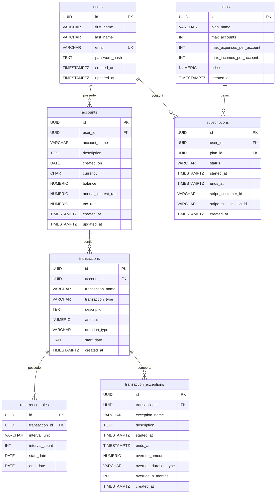

# Base de données et logique métier — Budgie V1

> **État documentaire :** 23 octobre 2026  
> **Référentiel analysé :** [Maissane-abd/Budgie-typeScript](https://github.com/Maissane-abd/Budgie-typeScript), branche `main`.  
> **Source principale du schéma :** [`db/init.sql`](https://github.com/Maissane-abd/Budgie-typeScript/blob/main/db/init.sql).  
> **Niveau de vérification :** schéma et traitements vérifiés **par lecture des fichiers du dépôt** ; **structure réelle, migrations historiques et données de la base en production non inspectées**. Une base déjà initialisée peut différer du SQL disponible dans Git.

Ce document décrit le modèle relationnel PostgreSQL de Budgie V1, les relations entre les entités, les contraintes effectivement définies par SQL, puis la manière dont l'API Express exploite les données pour les revenus, les dépenses, les abonnements et les prévisions.

## Sommaire

1. [Vue d'ensemble](#1-vue-densemble)
2. [Diagramme entité-relation](#2-diagramme-entité-relation)
3. [Dictionnaire des tables](#3-dictionnaire-des-tables)
4. [Clés, contraintes et suppressions en cascade](#4-clés-contraintes-et-suppressions-en-cascade)
5. [Index et types PostgreSQL](#5-index-et-types-postgresql)
6. [Règles métier implémentées](#6-règles-métier-implémentées)
7. [Revenus et dépenses récurrents](#7-revenus-et-dépenses-récurrents)
8. [Calculs des soldes et des prévisions](#8-calculs-des-soldes-et-des-prévisions)
9. [Exemples SQL de lecture](#9-exemples-sql-de-lecture)
10. [Initialisation, environnement et maintenance](#10-initialisation-environnement-et-maintenance)
11. [Points d'attention et dette technique](#11-points-dattention-et-dette-technique)
12. [Sources du dépôt](#12-sources-du-dépôt)

---

## 1. Vue d'ensemble

Le modèle défini dans `db/init.sql` comporte **7 tables** :

| Table | Fonction | Propriétaire fonctionnel |
| --- | --- | --- |
| `users` | Profils et comptes de connexion | Utilisateur |
| `accounts` | Comptes financiers (solde initial, devise, intérêts) | Utilisateur |
| `transactions` | Revenus et dépenses d'un compte | Compte financier |
| `recurrence_rules` | Paramètres de répétition d'une transaction | Transaction |
| `transaction_exceptions` | Exceptions ou ajustements prévus pour une transaction | Transaction |
| `plans` | Définition des offres et plafonds | Référentiel commun |
| `subscriptions` | Abonnements et identifiants Stripe | Utilisateur + offre |

**Choix de conception essentiel :** les revenus et les dépenses **ne possèdent pas deux tables distinctes**. La table `transactions` contient les deux, et la colonne `transaction_type` distingue `income` (revenu) et `expense` (dépense). Les routeurs REST séparent cependant les opérations fonctionnelles (`/api/revenus` et `/api/expenses`).

L'identifiant principal de chaque table est un **UUID** généré par PostgreSQL grâce à l'extension `uuid-ossp` et à `uuid_generate_v4()`.

## 2. Diagramme entité-relation

Le diagramme suivant peut être rendu directement dans GitHub :



**Légende :** `PK` = clé primaire, `FK` = clé étrangère, `UK` = valeur unique. La notation `||--o{` représente **un à plusieurs (0 à N)** au regard des contraintes SQL. Par exemple, bien que l'application manipule **une seule règle de récurrence par transaction** dans ses traitements, le schéma **n'impose pas** `UNIQUE(recurrence_rules.transaction_id)` : techniquement plusieurs règles peuvent être enregistrées pour la même transaction.

## 3. Dictionnaire des tables

La colonne *Obligatoire* indique les contraintes `NOT NULL` explicitement présentes dans le schéma ; une colonne peut être facultative tout en ayant une valeur `DEFAULT`.

### 3.1 `users` — utilisateurs

Conserve les informations nécessaires à l'inscription, à la connexion et à l'identification du propriétaire des comptes.

| Colonne | Type SQL | Obligatoire | Contrainte / valeur par défaut |
| --- | --- | --- | --- |
| `id` | `UUID` | Oui | PK ; `uuid_generate_v4()` |
| `first_name` | `VARCHAR(100)` | Oui | — |
| `last_name` | `VARCHAR(100)` | Oui | — |
| `email` | `VARCHAR(255)` | Oui | `UNIQUE` |
| `password_hash` | `TEXT` | Oui | Empreinte du mot de passe, jamais le mot de passe brut |
| `created_at` | `TIMESTAMPTZ` | Non | `now()` |
| `updated_at` | `TIMESTAMPTZ` | Non | `now()` |

Le backend hache les mots de passe avec `bcryptjs`. L'inscription crée également un compte intitulé **Compte Principal**, en euros, pour l'utilisateur nouvellement créé. Les routes d'authentification génèrent un JWT ; **le JWT n'est pas stocké dans cette table**.

### 3.2 `accounts` — comptes financiers

| Colonne | Type SQL | Obligatoire | Contrainte / valeur par défaut |
| --- | --- | --- | --- |
| `id` | `UUID` | Oui | PK ; UUID v4 |
| `user_id` | `UUID` | Oui | FK → `users.id` ; `ON DELETE CASCADE` |
| `account_name` | `VARCHAR(100)` | Oui | — |
| `description` | `TEXT` | Non | — |
| `created_on` | `DATE` | Oui | Date métier fournie lors de la création |
| `currency` | `CHAR(3)` | Oui | `'EUR'` |
| `balance` | `NUMERIC(18,2)` | Non | `0` |
| `annual_interest_rate` | `NUMERIC(6,4)` | Non | — |
| `tax_rate` | `NUMERIC(6,4)` | Non | — |
| `created_at` | `TIMESTAMPTZ` | Non | `now()` |
| `updated_at` | `TIMESTAMPTZ` | Non | `now()` |

**Attention :** `accounts.balance` est la valeur persistée servant de base à plusieurs calculs. Le `balance` retourné par `GET /api/accounts` est recalculé par une requête d'agrégation des transactions. Les champs API `current_balance` et `forecast_12m` sont **calculés à la volée** et **n'existent pas comme colonnes** de la table.

`annual_interest_rate` et `tax_rate` sont interprétés par le code comme des **pourcentages à diviser par 100** : `2.5` signifie 2,5 %. Le commentaire SQL qui donne `0.0250 = 2.5%` est incompatible avec cette implémentation et ne doit pas être pris comme référence de saisie.

### 3.3 `transactions` — revenus et dépenses

| Colonne | Type SQL | Obligatoire | Contrainte / valeur par défaut |
| --- | --- | --- | --- |
| `id` | `UUID` | Oui | PK ; UUID v4 |
| `account_id` | `UUID` | Oui | FK → `accounts.id` ; `ON DELETE CASCADE` |
| `transaction_name` | `VARCHAR(150)` | Oui | — |
| `transaction_type` | `VARCHAR(50)` | Oui | `CHECK` : `'income'` ou `'expense'` |
| `description` | `TEXT` | Non | — |
| `amount` | `NUMERIC(18,2)` | Oui | Aucune contrainte SQL `CHECK (amount > 0)` |
| `duration_type` | `VARCHAR(50)` | Non | Pas de `CHECK` SQL sur les valeurs |
| `start_date` | `DATE` | Oui | Date de référence de l'opération |
| `created_at` | `TIMESTAMPTZ` | Non | `now()` |

Le backend utilise les valeurs métier `one_time` et `recurring` pour `duration_type` ; la prévision traite une transaction comme récurrente uniquement si `duration_type = 'recurring'` **et** si une règle de récurrence associée est présente. Les autres cas sont traités comme ponctuels.

`amount` est enregistré comme un montant positif à la création via les contrôleurs. C'est `transaction_type` qui détermine son effet sur le solde : `+ amount` pour `income`, `- amount` pour `expense`.

### 3.4 `recurrence_rules` — règles de récurrence

| Colonne | Type SQL | Obligatoire | Contrainte / valeur par défaut |
| --- | --- | --- | --- |
| `id` | `UUID` | Oui | PK ; UUID v4 |
| `transaction_id` | `UUID` | Oui | FK → `transactions.id` ; `ON DELETE CASCADE` |
| `interval_unit` | `VARCHAR(20)` | Oui | `CHECK` : `'day'`, `'month'`, `'year'` |
| `interval_count` | `INT` | Oui | `1` ; pas de `CHECK (interval_count > 0)` |
| `start_date` | `DATE` | Oui | Début de la règle |
| `end_date` | `DATE` | Non | Fin facultative |

**Exemples :** (`month`, `1`) = chaque mois ; (`month`, `3`) = tous les trois mois ; (`year`, `1`) = chaque année. Le calcul actuel prend comme date de début **`transactions.start_date`** et non `recurrence_rules.start_date`.

### 3.5 `transaction_exceptions` — exceptions de transactions

| Colonne | Type SQL | Obligatoire | Contrainte / valeur par défaut |
| --- | --- | --- | --- |
| `id` | `UUID` | Oui | PK ; UUID v4 |
| `transaction_id` | `UUID` | Oui | FK → `transactions.id` ; `ON DELETE CASCADE` |
| `exception_name` | `VARCHAR(150)` | Non | — |
| `description` | `TEXT` | Non | — |
| `started_at` | `TIMESTAMPTZ` | Non | — |
| `ends_at` | `TIMESTAMPTZ` | Non | — |
| `override_amount` | `NUMERIC(18,2)` | Non | Montant de remplacement prévu |
| `override_duration_type` | `VARCHAR(50)` | Non | — |
| `override_n_months` | `INT` | Non | — |
| `created_at` | `TIMESTAMPTZ` | Non | `now()` |

La table existe dans `db/init.sql`, mais les contrôleurs revenus/dépenses et le calcul des prévisions **ne l'exploitent pas dans les chemins vérifiés**. Il s'agit d'une **capacité prévue dans le schéma**, et non d'une fonctionnalité de calcul d'exceptions à présenter comme opérationnelle en V1.

### 3.6 `plans` — offres d'abonnement

| Colonne | Type SQL | Obligatoire | Contrainte / valeur par défaut |
| --- | --- | --- | --- |
| `id` | `UUID` | Oui | PK ; UUID v4 |
| `plan_name` | `VARCHAR(100)` | Oui | — |
| `max_accounts` | `INT` | Non | `1` dans le schéma SQL |
| `max_expenses_per_account` | `INT` | Non | — |
| `max_incomes_per_account` | `INT` | Non | — |
| `price` | `NUMERIC(10,2)` | Oui | — |
| `created_at` | `TIMESTAMPTZ` | Non | `now()` |

Le script d'initialisation **crée la table mais n'insère aucune offre**. Les limites du plan gratuit appliquées par le backend sont codées comme valeurs de secours dans `utils/subscription.ts` : **2 comptes**, **2 revenus par compte**, **7 dépenses par compte**. Ne pas confondre ce comportement avec `plans.max_accounts DEFAULT 1` du SQL.

### 3.7 `subscriptions` — abonnements

| Colonne | Type SQL | Obligatoire | Contrainte / valeur par défaut |
| --- | --- | --- | --- |
| `id` | `UUID` | Oui | PK ; UUID v4 |
| `user_id` | `UUID` | Oui | FK → `users.id` ; `ON DELETE CASCADE` |
| `plan_id` | `UUID` | Oui | FK → `plans.id` ; suppression du plan non configurée en cascade |
| `status` | `VARCHAR(50)` | Oui | `CHECK` : `'active'`, `'canceled'`, `'trial'` |
| `started_at` | `TIMESTAMPTZ` | Oui | — |
| `ends_at` | `TIMESTAMPTZ` | Non | — |
| `stripe_customer_id` | `VARCHAR(255)` | Non | — |
| `stripe_subscription_id` | `VARCHAR(255)` | Non | — |
| `created_at` | `TIMESTAMPTZ` | Non | `now()` |

Le modèle peut représenter un abonnement et les références d'un prestataire de paiement. **La présence de la table n'implique pas que les paiements Stripe soient actifs en production.** Lors de l'inscription, le backend ne crée pas de ligne `subscriptions` : l'utilisateur reçoit une désignation fonctionnelle « Free » par défaut.

## 4. Clés, contraintes et suppressions en cascade

### 4.1 Relations matérialisées par des clés étrangères

| Colonne enfant | Référence parent | À la suppression du parent |
| --- | --- | --- |
| `accounts.user_id` | `users.id` | `CASCADE` |
| `subscriptions.user_id` | `users.id` | `CASCADE` |
| `subscriptions.plan_id` | `plans.id` | `NO ACTION` (comportement par défaut) |
| `transactions.account_id` | `accounts.id` | `CASCADE` |
| `recurrence_rules.transaction_id` | `transactions.id` | `CASCADE` |
| `transaction_exceptions.transaction_id` | `transactions.id` | `CASCADE` |

**Conséquences importantes :**

- Supprimer un utilisateur entraîne la suppression de ses comptes, transactions, règles, exceptions et abonnements associés.
- Supprimer un compte entraîne la suppression de ses transactions, puis des règles et exceptions liées.
- Supprimer une transaction efface ses règles et exceptions.
- Supprimer une offre `plans` encore référencée par des abonnements échouera normalement, car la FK ne déclare pas de cascade.

Les suppressions sont **définitives en base** sauf restauration depuis une sauvegarde. À ne jamais tester sur les données réelles d'un utilisateur.

### 4.2 Contraintes SQL effectivement présentes

- `users.email` est unique et obligatoire, mais l'unicité n'est pas explicitement insensible à la casse.
- `transactions.transaction_type` accepte uniquement `income` ou `expense`.
- `recurrence_rules.interval_unit` accepte uniquement `day`, `month` ou `year`.
- `subscriptions.status` accepte uniquement `active`, `canceled` ou `trial`.
- `transactions.amount > 0`, `recurrence_rules.interval_count > 0`, `end_date >= start_date`, et l'unicité d'une règle de récurrence par transaction **ne sont pas des contraintes SQL dans ce fichier**. Certaines sont contrôlées partiellement par l'API.

Ne pas attribuer à PostgreSQL des validations qui ne figurent que dans le code Node.js.

## 5. Index et types PostgreSQL

### 5.1 Index explicitement créés

| Nom | Table / colonnes | Usage probable |
| --- | --- | --- |
| `idx_accounts_user` | `accounts(user_id)` | Rechercher les comptes d'un utilisateur |
| `idx_transactions_account_start` | `transactions(account_id, start_date)` | Lister les opérations par compte et date |
| `idx_transactions_income_account` | `transactions(transaction_type, account_id)` | Filtrer les opérations par type et compte |

Les index nécessaires aux PK et à l'unicité de l'e-mail sont également créés automatiquement par PostgreSQL. L'index `idx_transactions_income_account` concerne en pratique les deux types (`income` et `expense`) ; ce n'est **pas** un index partiel limité aux revenus.

### 5.2 Pourquoi ces types ?

- `UUID` : identifiants non séquentiels et adaptés aux entités distribuées.
- `NUMERIC(18,2)` : représentation décimale exacte des montants enregistrés ; préférable à `FLOAT` pour la persistance monétaire.
- `NUMERIC(6,4)` : taux avec quatre décimales, attention à la convention pourcentage du code.
- `DATE` : dates métier des transactions et échéances.
- `TIMESTAMPTZ` : instants horodatés, avec gestion du fuseau horaire PostgreSQL.
- `CHAR(3)` : devise sous forme de code de trois caractères (défaut `EUR`) ; le schéma n'impose pas une liste ISO stricte.

**Remarque Node.js :** le pilote PostgreSQL `pg` renvoie fréquemment les colonnes `NUMERIC` comme des chaînes JavaScript. Le code utilise des conversions `Number(...)` pour effectuer ses calculs. Il faut veiller à l'arrondi et aux comparaisons lors de l'évolution des traitements financiers.

## 6. Règles métier implémentées

### 6.1 Authentification et propriété des ressources

L'API utilise `requireAuth` et l'identifiant d'utilisateur extrait du JWT. Les requêtes aux comptes filtrent par `accounts.user_id`, tandis que les opérations sur les revenus et dépenses passent par `transactions.account_id` puis la table `accounts` pour vérifier le propriétaire.

Une authentification JWT ne suffit pas à elle seule : la requête SQL doit également limiter les ressources à celles du bon utilisateur. La base n'utilise pas de mécanisme Row-Level Security (RLS) déclaré dans `db/init.sql`.

### 6.2 Création du compte principal

Lors de `POST /api/auth/register`, après l'insertion de `users`, l'API crée `accounts(account_name='Compte Principal', created_on=CURRENT_DATE, currency='EUR')`. Les autres valeurs viennent des défauts SQL. Ces deux insertions ne sont pas enveloppées dans une transaction SQL explicite dans le handler consulté.

### 6.3 Quotas gratuits et plan Premium

| Ressource | Limite gratuite appliquée par le backend | Point de contrôle |
| --- | --- | --- |
| Comptes | 2 par utilisateur | `POST /api/accounts` |
| Revenus | 2 par compte | `POST /api/revenus` |
| Dépenses | 7 par compte | `POST /api/expenses` |

Les contrôleurs comparent les compteurs aux plafonds **à la création**. Pour les revenus et dépenses, `utils/subscription.ts` applique les limites d'une offre active (ou les valeurs par défaut) et traite `Premium` comme illimité. Pour les comptes, la route vérifie directement un abonnement actif `Premium` et la limite gratuite de deux comptes.

Les offres `plans` et abonnements `subscriptions` correspondent à une intégration de paiement facultative, dont l'état effectif en production n'est pas déduit du seul schéma.

### 6.4 Validation des opérations

Les contrôleurs exigent à la création `account_id`, `transaction_name`, `amount`, `start_date`. Le montant doit être strictement positif. Si `duration_type = 'recurring'`, les paramètres `interval_count` et `interval_unit` sont requis et le premier doit être au moins égal à 1. La table vérifie ensuite les unités autorisées.

Le code vérifie que le compte appartient à l'utilisateur avant l'insertion. Les mises à jour et suppressions filtrent également par propriétaire et par `transaction_type`.

**Limite actuelle :** les contrôles applicatifs restent partiels (dates, formats numériques, valeurs de `duration_type`, bornes de taux, cohérence de fin de récurrence). Le schéma SQL n'impose pas toutes ces règles.

## 7. Revenus et dépenses récurrents

### 7.1 Enregistrement d'une opération ponctuelle

Un revenu ou une dépense ponctuelle crée une seule ligne dans `transactions` ; aucune ligne dans `recurrence_rules` n'est nécessaire.

Exemple **illustratif** d'informations métier :

```json
{
  "account_id": "11111111-1111-4111-8111-111111111111",
  "transaction_name": "Prime exceptionnelle",
  "amount": 250,
  "start_date": "2026-11-05",
  "duration_type": "one_time"
}
```

Le type `income` ou `expense` est fixé par la route appelée et non par un champ arbitraire du corps HTTP.

### 7.2 Enregistrement d'une opération récurrente

Une transaction récurrente implique **deux insertions** dans le code actuel :

1. Une ligne `transactions` avec `duration_type = 'recurring'` et le montant de référence.
2. Une ligne `recurrence_rules` associée via `transaction_id` pour la fréquence et les dates.

Exemple métier : un salaire de 2 000 € chaque mois à compter du 1er novembre 2026, sans date de fin :

```json
{
  "account_id": "11111111-1111-4111-8111-111111111111",
  "transaction_name": "Salaire",
  "amount": 2000,
  "start_date": "2026-11-01",
  "duration_type": "recurring",
  "interval_unit": "month",
  "interval_count": 1,
  "end_date": null
}
```

Ces valeurs sont un **exemple de requête**, pas des données réelles du projet. À la lecture du code, les deux écritures ne sont pas englobées dans une transaction SQL explicite : si la seconde échoue, la première peut rester enregistrée sans règle.

### 7.3 Génération des occurrences lors d'une prévision

Le module de prévision lit les transactions du compte et leurs règles. La fonction `getRecurringOccurrences()` :

1. Initialise une date à partir de `transactions.start_date`.
2. Ajoute une occurrence si elle est au plus tard à la date cible et, si définie, à la date de fin `recurrence_rules.end_date`.
3. Avance d'`interval_count` jours, mois ou années selon `interval_unit`.
4. Répète jusqu'à la date limite.

Les occurrences sont **calculées en mémoire** pour les projections : elles ne sont pas automatiquement écrites comme autant de lignes dans `transactions`.

**Comportements à connaître :**

- `recurrence_rules.start_date` est enregistré, mais n'est **pas utilisé comme point de départ** dans cette fonction.
- Les dates de fin sont comparées de manière inclusive (`currentDate <= endDate`).
- Le calcul avec `Date.setMonth()` peut décaler les occurrences proches de la fin du mois (ex. 31 janvier).
- `interval_count = 0` n'est pas rejeté par une contrainte SQL ; si cette valeur atteint le calcul, la boucle peut ne jamais avancer.
- Une transaction marquée `recurring` mais sans règle jointe est traitée comme ponctuelle.
- Lorsqu'une opération devient ponctuelle lors d'une modification, son ancienne règle est supprimée ; à l'inverse, une règle est ajoutée ou actualisée lors du passage à `recurring`.

### 7.4 Exceptions de récurrence

La table `transaction_exceptions` prévoit des modifications temporaires ou personnalisées de certaines transactions. Cependant, les chemins API et le module `previsions.ts` examinés **n'utilisent pas** ces exceptions dans le calcul. Il ne faut donc pas promettre de prise en compte des interruptions, montants ponctuellement modifiés ou dérogations dans les prévisions V1.

## 8. Calculs des soldes et des prévisions

**Il existe deux traitements distincts :** la liste des comptes (`GET /api/accounts`) et la simulation (`GET /api/previsions`). Ils n'utilisent pas exactement la même notion de solde de départ.

### 8.1 Solde calculé dans `GET /api/accounts`

La requête agrège les lignes de `transactions` associées à chaque compte :

```text
solde_retourné = accounts.balance
              + somme(transactions.amount pour income)
              - somme(transactions.amount pour expense)
```

La requête ne filtre pas les transactions sur la date et ne développe pas leurs occurrences récurrentes. Une opération `recurring` contribue donc **une seule fois**, comme toute ligne de `transactions`, à cette agrégation.

Le résultat est exposé sous le nom `balance`, mais **ne remplace pas la valeur stockée** dans `accounts.balance`.

### 8.2 Champs calculés `current_balance` et `forecast_12m`

Le module `accounts.ts` ajoute aux données du compte :

- `current_balance` : solde agrégé, augmenté d'une **mensualité d'intérêts nets théoriques**.
- `forecast_12m` : solde obtenu en composant des intérêts mensuels nets pendant **12 mois**, sans génération des revenus et dépenses récurrents sur cette période.

La formule utilisée dans cette partie peut s'exprimer comme suit :

```text
r_mensuel = (annual_interest_rate / 100) / 12
coefficient_net = 1 - (tax_rate / 100)
interet_net_mois = solde * r_mensuel * coefficient_net
nouveau_solde = solde + interet_net_mois
```

Le calcul sur douze mois applique cette mise à jour douze fois, puis arrondit le résultat final à deux décimales. Il représente une projection d'intérêts **distincte** du calcul de `/api/previsions`.

### 8.3 Simulation dans `GET /api/previsions`

La route prend un paramètre facultatif `target_date=YYYY-MM-DD` et choisit environ un an dans le futur s'il est absent. Pour chaque compte de l'utilisateur :

1. Récupérer la ligne `accounts` et la valeur **stockée** `accounts.balance`.
2. Lire les transactions associées, avec `LEFT JOIN recurrence_rules`.
3. Générer les occurrences récurrentes jusqu'à `target_date` ; conserver une occurrence pour les autres transactions.
4. Regrouper les occurrences sur chaque mois simulé, du **mois en cours** jusqu'au mois de la date cible.
5. Ajouter les revenus, retrancher les dépenses, puis appliquer les intérêts nets du mois.
6. Produire les détails mensuels, le solde projeté par compte et les sommes globales.

Formule du mois *m* utilisée par le code :

```text
S_m_apres_operations = S_m_debut + revenus_m - depenses_m
interets_m = S_m_apres_operations
           * (annual_interest_rate / 100 / 12)
           * (1 - tax_rate / 100)
S_m_fin = S_m_apres_operations + interets_m
```

Le résultat JSON comprend `target_date`, `accounts[]` avec `starting_balance`, `forecasted_balance`, `monthly_details[]` (`month`, `income`, `expense`, `interest`, `balance`), puis `total_starting_balance` et `total_forecasted_balance`.

### 8.4 Différences à ne pas masquer

| Aspect | `GET /api/accounts` | `GET /api/previsions` |
| --- | --- | --- |
| Point de départ | `accounts.balance` **plus** sommes des lignes de transactions | `accounts.balance` **stocké** |
| Opérations récurrentes | Chaque ligne une seule fois | Occurrences générées selon `recurrence_rules` |
| Fenêtre temporelle | Aucun filtre de date sur l'agrégation | Boucle mensuelle depuis le mois courant jusqu'à la cible |
| Intérêts | Projection isolée dans `current_balance` / `forecast_12m` | Intérêts calculés après les opérations de chaque mois |
| Exceptions | Non exploitées | Non exploitées |

**Conséquence :** les chiffres des deux routes peuvent diverger pour un même compte. Dans la projection, les occurrences antérieures au mois en cours sont générées mais ne sont **pas imputées aux mois simulés**, tandis que le solde de départ reste `accounts.balance`. Selon les données saisies, cela peut produire un écart notable avec le solde affiché par `/api/accounts`.

**Autres limites :** absence de validation stricte de `target_date`, calculs fondés sur `Number` côté JavaScript, arrondi partiel et gestion des échéances mensuelles via `Date` pouvant entraîner des effets de bord calendaires.

## 9. Exemples SQL de lecture

**Ces requêtes sont informatives et en lecture seule.** Ne pas les exécuter sur une base de production contenant des données personnelles si vous ne disposez pas des droits et du besoin de le faire.

### 9.1 Lister les comptes d'un utilisateur

```sql
SELECT id, account_name, currency, balance, annual_interest_rate
FROM accounts
WHERE user_id = $1
ORDER BY created_on DESC;
```

`$1` représente un UUID utilisateur fourni par une application backend ou un client SQL paramétré.

### 9.2 Lister les revenus d'un compte

```sql
SELECT id, transaction_name, amount, start_date, duration_type
FROM transactions
WHERE account_id = $1
  AND transaction_type = 'income'
ORDER BY start_date DESC;
```

### 9.3 Lire une opération avec sa règle de récurrence

```sql
SELECT
  t.id,
  t.transaction_name,
  t.transaction_type,
  t.amount,
  t.start_date,
  r.interval_unit,
  r.interval_count,
  r.end_date
FROM transactions AS t
LEFT JOIN recurrence_rules AS r
  ON r.transaction_id = t.id
WHERE t.id = $1;
```

**Attention :** plusieurs lignes peuvent être renvoyées si plusieurs règles ont été créées pour une seule transaction, car la base ne garantit pas l'unicité de `transaction_id` dans `recurrence_rules`.

### 9.4 Répartir les revenus et dépenses par compte

```sql
SELECT
  account_id,
  SUM(CASE WHEN transaction_type = 'income' THEN amount ELSE 0 END) AS revenus,
  SUM(CASE WHEN transaction_type = 'expense' THEN amount ELSE 0 END) AS depenses
FROM transactions
GROUP BY account_id;
```

Cette agrégation porte sur les **lignes enregistrées**, pas sur les occurrences générées par les règles de récurrence.

### 9.5 Compter les transactions d'un compte pour vérifier les quotas

```sql
SELECT
  transaction_type,
  COUNT(*) AS nombre
FROM transactions
WHERE account_id = $1
GROUP BY transaction_type;
```

## 10. Initialisation, environnement et maintenance

### 10.1 Conteneur PostgreSQL local

La configuration `compose.yml` utilise **PostgreSQL 15** avec un volume persistant `db_data`. Le fichier `./db/init.sql` est monté sur `/docker-entrypoint-initdb.d/init.sql`.

Ce fichier d'initialisation est exécuté **lors de la création initiale d'un répertoire de données PostgreSQL vide**, pas à chaque redémarrage du conteneur. Modifier `db/init.sql` dans Git ne met **pas automatiquement à jour** une base déjà existante.

### 10.2 Examiner le schéma depuis Docker

À la racine du dépôt, si les services locaux sont démarrés :

```bash
# Consulter l'état des services
docker compose ps

# Ouvrir une session psql avec les paramètres du conteneur
docker compose exec db sh -lc 'psql -U "$POSTGRES_USER" -d "$POSTGRES_DB"'
```

Dans `psql` :

```sql
\dt
\d users
\d accounts
\d transactions
\d recurrence_rules
\d transaction_exceptions
\d plans
\d subscriptions
\di
```

Pour quitter : `\q`.

**Sécurité :** ne pas publier de dump réel, d'adresses e-mail, d'empreintes de mots de passe, de secrets ou de données financières dans GitHub, les tickets ou des captures d'écran.

### 10.3 Vérification de l'existant avant une évolution du schéma

Pour modifier la structure dans une future version, prévoir des **migrations versionnées** et tester celles-ci sur une base locale de test. Ne pas compter sur la modification de `init.sql` pour migrer une base contenant déjà des données.

**Ne pas utiliser `docker compose down -v` pour « relancer l'initialisation » sur une base à conserver : cette commande supprime les volumes Docker et peut entraîner une perte définitive de données.**

## 11. Points d'attention et dette technique

Ces constats décrivent des **risques ou limites visibles dans le code**, pas nécessairement des incidents observés sur le site de production.

| Priorité indicative | Constat vérifié dans le code ou le schéma | Piste pour une future version |
| --- | --- | --- |
| Haute | `/api/accounts` et `/api/previsions` ne calculent pas le solde de la même façon | Définir une source de vérité pour solde initial, solde courant et historique |
| Haute | `interval_count` n'a pas de `CHECK > 0` ; une valeur nulle ou non positive peut compromettre la génération d'occurrences | Ajouter contrainte SQL, validation applicative et garde dans la boucle |
| Haute | Insertions `transactions` puis `recurrence_rules` sans transaction SQL explicite | Utiliser `BEGIN`/`COMMIT`/`ROLLBACK` sur le même client `pg` |
| Moyenne | Une transaction peut avoir plusieurs règles en base malgré une logique supposant une seule règle | Évaluer `UNIQUE (transaction_id)` après audit des données existantes |
| Moyenne | `transaction_exceptions` existe mais n'est pas intégré dans les prévisions vérifiées | Définir une vraie logique d'exceptions avant de l'exposer dans l'API |
| Moyenne | Saisie des taux incohérente avec un commentaire SQL (`0.0250` contre `2.5`) | Fixer une convention unique, documenter et tester les conversions |
| Moyenne | Les prévisions mensuelles utilisent des dates JavaScript et peuvent décaler certaines échéances | Définir une politique de récurrence calendaire, gérer les fins de mois et fuseaux |
| Moyenne | Les champs `updated_at` ne sont pas tous actualisés lors des modifications dans les routes consultées | Ajouter une mise à jour explicite ou un trigger PostgreSQL |
| Moyenne | La validation SQL des montants, des dates de fin et de l'ordre des bornes est incomplète | Ajouter des `CHECK`, avec migration après analyse des données |
| Moyenne | `db/init.sql` décrit une création initiale, pas un système de migrations | Introduire des migrations versionnées avant les évolutions V2 |
| Basse | Le modèle de tarifs offre une valeur par défaut `max_accounts=1`, tandis que l'API utilise 2 comptes gratuits | Unifier les règles métier et les valeurs de référence |

### Évolutions envisagées, **non implémentées en V1**

- Revenus dépendant d'un pourcentage d'un autre revenu (par exemple affectation d'épargne).
- Suivi de la valorisation d'ETF et calcul de plus-values ou moins-values.
- Un moteur de prévisions consolidé avec prise en charge des exceptions.

Ces fonctionnalités nécessiteraient de nouveaux choix de modèle de données ; elles ne doivent pas être représentées comme des tables ou relations existantes.

## 12. Sources du dépôt

Sources consultées lors de la rédaction :

- [`db/init.sql`](https://github.com/Maissane-abd/Budgie-typeScript/blob/main/db/init.sql) — tables, colonnes, FK, contraintes et index.
- [`backend/src/models/db.ts`](https://github.com/Maissane-abd/Budgie-typeScript/blob/main/backend/src/models/db.ts) — pool de connexions PostgreSQL (`pg`).
- [`backend/src/routes/auth.ts`](https://github.com/Maissane-abd/Budgie-typeScript/blob/main/backend/src/routes/auth.ts) — inscription, compte principal et JWT.
- [`backend/src/routes/accounts.ts`](https://github.com/Maissane-abd/Budgie-typeScript/blob/main/backend/src/routes/accounts.ts) — soldes calculés et gestion des comptes.
- [`backend/src/controllers/revenusController.ts`](https://github.com/Maissane-abd/Budgie-typeScript/blob/main/backend/src/controllers/revenusController.ts) — revenus et récurrences.
- [`backend/src/controllers/expensesController.ts`](https://github.com/Maissane-abd/Budgie-typeScript/blob/main/backend/src/controllers/expensesController.ts) — dépenses et récurrences.
- [`backend/src/routes/previsions.ts`](https://github.com/Maissane-abd/Budgie-typeScript/blob/main/backend/src/routes/previsions.ts) — projection mensuelle et création d'occurrences.
- [`backend/src/utils/subscription.ts`](https://github.com/Maissane-abd/Budgie-typeScript/blob/main/backend/src/utils/subscription.ts) — limites gratuites et Premium.
- [`compose.yml`](https://github.com/Maissane-abd/Budgie-typeScript/blob/main/compose.yml) et [`compose.production.yml`](https://github.com/Maissane-abd/Budgie-typeScript/blob/main/compose.production.yml) — service PostgreSQL et exploitation Docker.

**Document complémentaire :** [`api.md`](./api.md) pour les routes HTTP, leurs paramètres, les réponses et les erreurs.

---

**Périmètre de validité :** la documentation correspond à la lecture du code et du schéma SQL présents sur `main` au **23 octobre 2026**. Pour certifier la structure effectivement déployée sur `monbudgie.fr`, comparer les métadonnées PostgreSQL du conteneur de production avec `db/init.sql`, sans extraire ni divulguer de données utilisateur.
