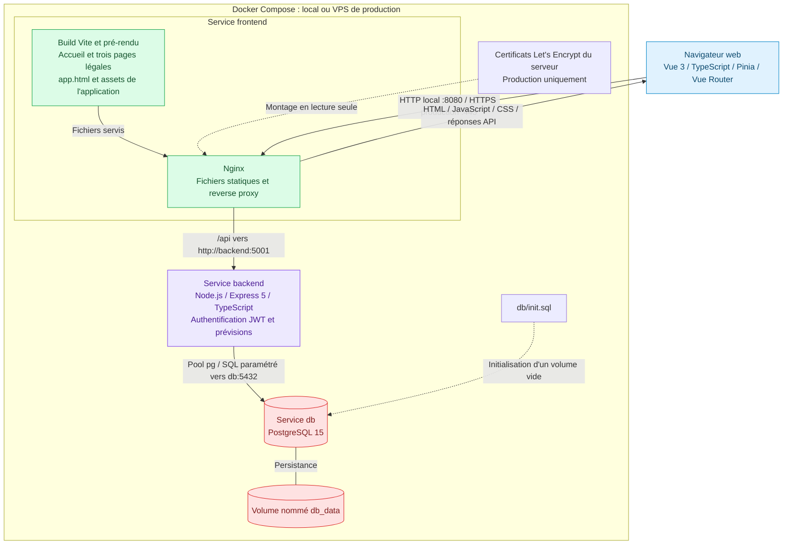

# Diagramme d'architecture — Budgie v2

État des configurations du dépôt au 26 novembre 2026. Ce diagramme décrit les
trois services Compose ; il ne certifie pas l'état du VPS déployé.

Vue s'exécute dans le navigateur. Nginx appartient au conteneur `frontend` et sert
les fichiers générés pendant le build ; aucun serveur Vite ou de rendu Vue à la
demande n'est lancé en production. Les appels `/api` sont transmis au backend,
qui est le seul composant applicatif à accéder à PostgreSQL.

| Configuration                                         | Ports publiés sur l'hôte                                                                             |
| ----------------------------------------------------- | ---------------------------------------------------------------------------------------------------- |
| Locale : `compose.yml`                                | Frontend `8080:80`, backend `5001:5001`, PostgreSQL `5432:5432`.                                     |
| Production : `compose.yml` + `compose.production.yml` | Frontend `443:443` et `8080:80` hérité ; ports backend et PostgreSQL retirés. Aucun `80:80` déclaré. |

Le diagramme présente le routage prévu. Les écarts de casse des Dockerfiles, les
sondes de santé et les références d'authentification aux tables manquantes restent
suivis dans les [limites connues](known-limitations.md).

Sources : [Compose local](../compose.yml), [surcharge production](../compose.production.yml),
[Dockerfile frontend](../frontend/dockerfile), [Nginx local](../nginx/default.dev.conf)
et [Nginx production](../nginx/default.conf).

[Architecture détaillée](architecture.md) · [Installation](installation.md) · [README](../README.md)
